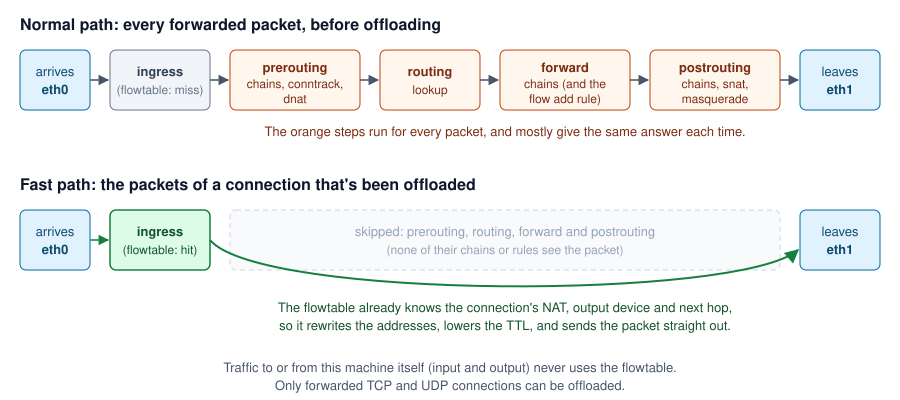
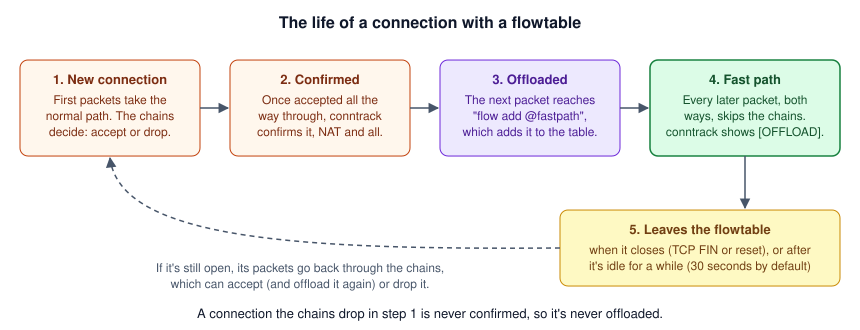

# Flowtables

- [In short](#in-short)
- [How a forwarded packet normally travels](#how-a-forwarded-packet-normally-travels)
- [What a flowtable does](#what-a-flowtable-does)
- [The life of an offloaded connection](#the-life-of-an-offloaded-connection)
- [Setting one up](#setting-one-up)
- [Where the offload rule goes](#where-the-offload-rule-goes)
- [What changes for offloaded connections](#what-changes-for-offloaded-connections)
- [Is it worth it?](#is-it-worth-it)
- [Checking it works](#checking-it-works)
- [Turning it off](#turning-it-off)
- [Common mistakes](#common-mistakes)

## In short
| | |
|---|---|
| **What** | A fast path for connections this machine forwards, e.g. as a router or NAT gateway |
| **How** | Once a connection has been accepted, its packets skip the chains and the routing lookup, and are sent straight out of the right device, with their NAT applied |
| **Gain** | Much less CPU per forwarded packet, so more throughput and lower latency on the same hardware |
| **Cost** | The chains no longer see an offloaded connection's packets, so they can't count, log, limit or drop them until it leaves the flowtable |
| **Works for** | Forwarded TCP and UDP. Not traffic to or from this machine itself, and not ICMP. |
| **Needs** | nft 1.0.6 (e.g. Debian 12), as older nft can't read a flowtable's devices from JSON |
| **Classes** | `Flowtable`, and `RuleFactory::createFlowOffload()` (or a `FlowOffloadStatement`) |

The examples leave out `use` statements. Every class is in `Programster\Nftables`, or one of its `Enums`,
`Statements`, `Expressions` and `Exceptions` namespaces.

## How a forwarded packet normally travels
A packet that a gateway forwards, e.g. from the internet (on `eth0`) to a machine behind it (on `eth1`), passes
through a series of hooks. Each hook runs the chains attached to it, in priority order:

| Step | Hook | What happens there |
|---|---|---|
| 1 | ingress (of `eth0`) | Chains on the ingress hook. This is where a flowtable looks the packet up. |
| 2 | prerouting | Conntrack finds (or starts) the packet's connection. Filter chains, then DNAT (e.g. port forwards). |
| 3 | routing | The kernel decides where the packet goes: to this machine (input) or on to another (forward). |
| 4 | forward | The forward chains decide whether it's allowed through. |
| 5 | postrouting | Chains, then SNAT and masquerading, then the packet leaves by `eth1`. |

Steps 2 to 5 run for every packet, but for a connection that's already been accepted, they give the same answer every
time: the same NAT, the same route, the same verdict. With a lot of traffic, that repeated work is most of what the
gateway's CPU spends its time on.

## What a flowtable does
A flowtable remembers each offloaded connection's answers: its NAT, the device it leaves by, and the next hop. When a
packet of that connection arrives on one of the flowtable's devices, the flowtable finds it at step 1, rewrites its
addresses, lowers its TTL, and sends it straight out, skipping steps 2 to 5:



The chains still decide which connections are allowed, as a connection's first packets always take the normal path.
The flowtable only takes over once they've been accepted.

## The life of an offloaded connection


1. **New connection.** Its first packets take the normal path. The chains accept or drop it as usual, and NAT
   decides how it's translated.
2. **Confirmed.** A connection that's made it all the way through is confirmed by conntrack. One that was dropped
   never is.
3. **Offloaded.** The next packet to reach the offload rule (`flow add @fastpath`) in the forward chain adds the
   connection to the flowtable.
4. **Fast path.** Every later packet, in both directions, takes the fast path. `conntrack -L` marks the connection
   `[OFFLOAD]`.
5. **Leaves the flowtable** when it closes (its TCP FIN or reset goes back through the chains), or after it's idle for
   a while (30 seconds by default). If it's still open, its next packets take the normal path again, where the chains
   can accept it (and it's offloaded again) or drop it.

## Setting one up
A `Flowtable` takes its name, its table (an `ip`, `ip6` or `inet` one), a priority, and the devices whose traffic it
handles. List both sides of the connections, e.g. the WAN and LAN interfaces: only packets arriving on a listed device
take the fast path. `RuleFactory::createFlowOffload()` creates the rule that offloads TCP and UDP connections to it,
which belongs in the forward chain:

```php
$table = new Table("gateway", Family::INET);
$forward = new BaseChain("forward", $table, ChainType::FILTER, ChainHook::FORWARD, Priority::FILTER, Policy::DROP);
$fastpath = new Flowtable("fastpath", $table, Priority::FILTER, "eth0", "eth1");
$established = new ConnectionStateSet(ConnectionState::ESTABLISHED, ConnectionState::RELATED);

$ruleset = new Ruleset(NftablesTarget::DEBIAN_12);
$ruleset->addRule(RuleFactory::createFlowOffload($forward, $fastpath));
$ruleset->addRule(RuleFactory::createForward($forward, "eth0", "eth1", $established));
$ruleset->addRule(RuleFactory::createForward($forward, "eth1", "eth0"));
```

```nft
flowtable fastpath {
	hook ingress priority filter
	devices = { eth0, eth1 }
}

meta l4proto { tcp, udp } flow add @fastpath
```

Adding the rule adds the flowtable to the ruleset too.

Every device must exist when the ruleset is loaded, or nft refuses to load the whole ruleset, which leaves the old
rules in place. So list only devices that always exist at boot, before the firewall loads, e.g. not a VPN interface
that only appears once the VPN connects.

## Where the offload rule goes
The offload rule only offloads connections that conntrack has confirmed, so it can go first in the forward chain: a
connection still has to be accepted by the rules after it before it can be offloaded. Rules that should keep applying
to connections that were already allowed go before it:

```text
chain forward {
    type filter hook forward priority filter; policy drop;

    ip saddr @blocklist drop                         <- before: drops a blocked address's packets before they
                                                        can be offloaded
    meta l4proto { tcp, udp } flow add @fastpath     <- offloads confirmed connections

    iifname "eth0" oifname "eth1" ct state established,related accept   <- after: these decide which
    iifname "eth1" oifname "eth0" accept                                 connections are allowed at all
}
```

A connection that's already offloaded doesn't see any of these until it leaves the flowtable, so adding an address
to the blocklist cuts off its new connections straight away, but its existing ones only once they close or go idle.
To cut those off at once, delete them from conntrack (`conntrack -D -s 198.51.100.7`).

## What changes for offloaded connections
| Still applies | No longer applies (until the connection leaves the flowtable) |
|---|---|
| Its NAT: port forwards and masquerading keep working | Rules in the prerouting, forward and postrouting chains |
| The route and next hop chosen for its first packets | Counters, logging, rate limits and quotas in those chains |
| Conntrack: the connection stays tracked, and shows in `conntrack -L` | Changes those rules make to each packet, e.g. setting its mark |
| The chains' decision on new connections | A newly added rule that would drop it |
| Traffic to and from this machine (input and output), which never uses the flowtable | |

Some connections are never offloaded:

- anything but TCP and UDP, e.g. ICMP and ping.
- connections with a [conntrack helper](objects.md#conntrack-helpers) (e.g. FTP), as the helper has to read every
  packet.
- packets arriving on a device that isn't in the flowtable.

A flowtable can also offload connections to the network card itself (hardware offload), on cards that support it,
and count the packets it handles (its counter flag). Neither is available here: nft's JSON parser silently ignores a
flowtable's flags, in every version up to at least 1.1.6, so a ruleset loaded with `nft --json` can't set them.

## Is it worth it?
It depends on how hard the gateway's CPU works to forward traffic. Check while it's busy, e.g. with `mpstat 1` (from
the sysstat package) or `top`: forwarding shows up as softirq time (`%soft`, or `si` in top).

| Sign | Likely benefit |
|---|---|
| Softirq time is high when traffic is heavy, or throughput stops rising while a CPU is busy | Large: the flowtable takes most of that work away |
| Lots of small packets (e.g. VoIP, games, DNS heavy traffic, many small requests) | Large: per packet costs dominate |
| Long transfers through the gateway (backups, registry pushes, downloads) | Good: those connections spend almost all their time offloaded |
| The gateway mostly serves traffic itself, rather than forwarding it | None: only forwarded traffic is offloaded |
| Forwarding barely registers on the CPU | Small: little to save, though nothing lost either |
| You rely on counters, logs or limits in the forward chain for every packet | A trade-off: those stop counting offloaded packets |

Measure before and after (e.g. with `iperf3` between a machine on each side), rather than assuming.

## Checking it works
| To | Run |
|---|---|
| See the flowtable and its devices | `nft list flowtables` |
| See which connections are offloaded | `conntrack -L \| grep OFFLOAD` (from the conntrack package) |
| Count the offloaded connections | `conntrack -L 2>/dev/null \| grep -c OFFLOAD` |
| Change how long an idle TCP connection stays offloaded (newer kernels) | `sysctl net.netfilter.nf_flowtable_tcp_timeout` |

An offloaded connection looks like this:

```text
tcp      6 src=198.51.100.7 dst=203.0.113.1 sport=51514 dport=443 src=10.0.0.3 dst=198.51.100.7 sport=443 dport=51514 [OFFLOAD] mark=0 use=2
```

If nothing is ever offloaded, check that the offload rule is in the forward chain, that the traffic arrives on one of
the flowtable's devices, and that it's TCP or UDP.

## Turning it off
Remove the offload rule (and the flowtable) from the PHP, and reload. Deleting the flowtable takes every connection out
of it, and they carry on through the chains as normal, so nothing is cut off. As the ruleset loads in one transaction,
there's no moment without a firewall.

## Common mistakes
| Symptom | Likely cause | Fix |
|---|---|---|
| The ruleset won't load: "Could not process rule: No such file or directory" | A device in the flowtable doesn't exist (yet) | Only list devices that exist when the firewall loads |
| `UnsupportedFeatureException` for a flowtable | The target's nft is older than 1.0.6 | Use a newer target, or go without a flowtable |
| `UnsuitableChainException` for the offload rule | It's not in a filter chain on the forward hook | Put it in the forward chain |
| A blocked address can still use a connection it already had | The connection is offloaded, so the forward chain doesn't see it | Wait for it to close or go idle, or delete it with `conntrack -D` |
| Forward chain counters stop going up | Offloaded packets skip the chain | Expected: rules only count the packets they see. Count per connection instead, e.g. with `conntrack -L`, or leave out the flowtable if per packet counts matter more |
| Nothing is offloaded | The traffic isn't TCP or UDP, arrives on a device that isn't listed, or has a conntrack helper | Check the devices, and see [checking it works](#checking-it-works) |
