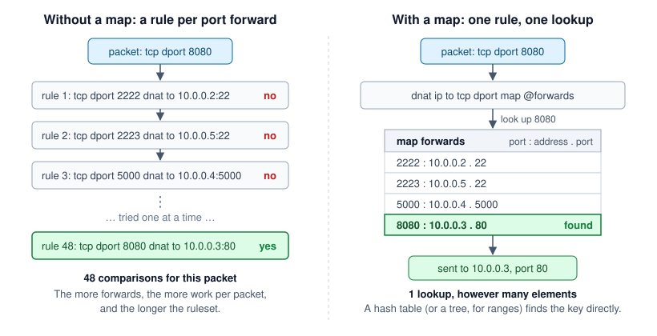
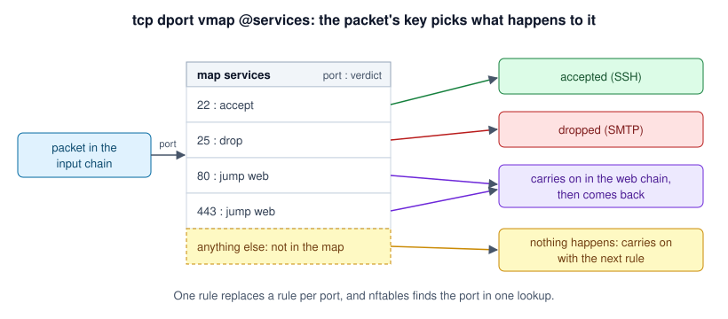

# Maps and verdict maps

- [In short](#in-short)
- [How a map works](#how-a-map-works)
- [Sets, maps and verdict maps compared](#sets-maps-and-verdict-maps-compared)
- [Reading a map](#reading-a-map)
- [Maps](#maps)
- [Port forwarding with a map](#port-forwarding-with-a-map)
  - [Worked example: port forwards with an allowlist](#worked-example-port-forwards-with-an-allowlist)
- [Verdict maps](#verdict-maps)
- [Anonymous maps](#anonymous-maps)
- [Looking after a map](#looking-after-a-map)
- [Common mistakes](#common-mistakes)
- [Which nft is needed](#which-nft-is-needed)

## In short
| | What it is | Example (as nft lists it) |
|---|---|---|
| **Map** (`NamedMap`) | A lookup table from a key in the packet to a value, which a statement then uses | `dnat ip to tcp dport map @forwards` |
| **Verdict map** (`NamedVerdictMap`) | A lookup table from a key in the packet to what happens to it: accept, drop, or a jump to a chain | `tcp dport vmap @services` |
| **Anonymous map** (`AnonymousMap`, `AnonymousVerdictMap`) | Either kind, written into the rule itself, for a fixed list only one rule uses | `tcp dport vmap { 22 : accept, 25 : drop }` |

Use one when a rule would otherwise be repeated once per port, address or interface, with only the values changing.
The examples leave out `use` statements. Every class is in `Programster\Nftables`, or one of its `Enums`,
`Statements`, `Expressions` and `Exceptions` namespaces.

```php
$table = new Table("gateway", Family::IP);
$prerouting = new BaseChain("prerouting", $table, ChainType::NAT, ChainHook::PREROUTING, Priority::DSTNAT, Policy::ACCEPT);
$input = new BaseChain("input", $table, ChainType::FILTER, ChainHook::INPUT, Priority::FILTER, Policy::DROP);
$destinationPort = PayloadExpression::create(PayloadField::TCP_DPORT);
$sourceAddress = PayloadExpression::create(PayloadField::IP_SADDR);
$ruleset = new Ruleset();
```

## How a map works
A map is nftables' version of a PHP associative array. Port forwards written as one would look like this, with the
incoming port as the key, and where to send it as the value:

```text
$forwards = [
    2222 => ["10.0.0.2", 22],
    2223 => ["10.0.0.5", 22],
    5000 => ["10.0.0.4", 5000],
    8080 => ["10.0.0.3", 80],
];

$destination = $forwards[$packet->destinationPort] ?? null;   // null: not forwarded
```

That's exactly what a map does inside the kernel. The rule names the part of the packet to use as the key (here, the
TCP destination port), looks it up in the map, and uses the value it finds (here, as the address and port to DNAT
to). If the key isn't in the map, the rule doesn't match, and the packet carries on to the next rule as if the rule
weren't there.



Without a map, each port forward is a rule of its own, and nftables tries the rules in order until one matches, so a
packet for the 48th forward is compared 48 times. A map is a hash table (or a tree, for ranges), which finds the key in
one step, so it takes the same time with 5 elements as with 5,000. That gives three benefits, in order of how much
they matter for most firewalls:

| Benefit | Why it matters |
|---|---|
| **A short, readable ruleset** | One rule, plus a list of forwards, instead of a near identical rule per forward. Adding a forward is adding a line to a list. |
| **Changes without a reload** | Elements can be added and removed while it's loaded (`nft add element`), without touching the rules. |
| **Speed** | One lookup instead of a comparison per rule. Noticeable with hundreds of elements and lots of traffic. With a few dozen, the difference is too small to measure. |

## Sets, maps and verdict maps compared
| | [Named set](sets.md) | Map | Verdict map |
|---|---|---|---|
| Holds | Keys | Keys, each with a value | Keys, each with a verdict |
| Answers | "Is this packet's key in the set?" | "What value goes with this packet's key?" | "What should happen to a packet with this key?" |
| Used by | A match, e.g. `ip saddr @allowlist` | A statement's value, e.g. `dnat to tcp dport map @forwards` | Its own statement, `tcp dport vmap @services` |
| Key not found | The match fails, so the rule stops | The rule stops, so nothing is translated or set | Nothing happens. The packet carries on with the next rule. |
| Typical use | Allowlists and blocklists | Port forwards, marks per address | A chain per service, interface or network |
| Class | `NamedSet` | `NamedMap` | `NamedVerdictMap` |

All three can hold ranges and prefixes (with `SetFlag::INTERVAL`), and keys that are a concatenation of several values
(e.g. an address and a port). Sets and maps share their names in a table, so a set and a map can't have the same name.

## Reading a map
This is how nft lists the map in [port forwarding with a map](#port-forwarding-with-a-map) below, and what each part
means:

```text
map forwards {                                  <- the map's name, used in rules as @forwards
    type inet_service : ipv4_addr . inet_service    <- the key's type : the value's type
                                                       (inet_service is a port, and "a . b" is a
                                                       concatenation: both values together)
    elements = { 2222 : 10.0.0.2 . 22,          <- key 2222 maps to address 10.0.0.2, port 22
                 8080 : 10.0.0.3 . 80 }         <- key 8080 maps to address 10.0.0.3, port 80
}

iifname "eth0" dnat ip to tcp dport map @forwards
|------------| |------------| |--------------------|
  only packets   translate the   key: the packet's TCP destination port,
  from the WAN   destination     looked up in @forwards, for the address
                 (IPv4)          and port to send it to
```

The types are `SetType`s. The common ones:

| `SetType` | nft's name | Holds |
|---|---|---|
| `IPV4_ADDR`, `IPV6_ADDR` | `ipv4_addr`, `ipv6_addr` | An address (or a network, with `SetFlag::INTERVAL`) |
| `INET_SERVICE` | `inet_service` | A port (or a range, with `SetFlag::INTERVAL`) |
| `INET_PROTO` | `inet_proto` | A protocol, e.g. tcp |
| `IFNAME` | `ifname` | An interface name |
| `MARK` | `mark` | A packet or connection mark |
| `ETHER_ADDR` | `ether_addr` | A MAC address |

## Maps
`NamedMap::create()` takes the table, the map's name, the type of its keys and the type of its values (each a `SetType`,
or a `SetTypeCollection` for a concatenation), and any `SetFlag`s. `withElements()` gives a copy with its elements,
each a `MapElement` of a key and a value. `lookUp()` gives an expression for the value the packet's key maps to:

```php
$marks = NamedMap::create($table, "marks", SetType::IPV4_ADDR, SetType::MARK);
$marks = $marks->withElements(new MapElement("10.0.0.2", 1), new MapElement("10.0.0.3", 2));
$markBySource = new MangleStatement(new MetaExpression(MetaKey::MARK), $marks->lookUp($sourceAddress));
$ruleset->addRule(Rule::create($input, $markBySource));
```

```nft
map marks {
	type ipv4_addr : mark
	elements = { 10.0.0.2 : 0x00000001,
		     10.0.0.3 : 0x00000002 }
}

meta mark set ip saddr map @marks
```

A packet whose key isn't in the map doesn't match the rule, so the rule does nothing to it. Adding a rule that uses a
map adds the map to the ruleset too. As with sets, keys that are ranges (`PortRange`) or prefixes need
`SetFlag::INTERVAL`, and sets and maps share their names, so a set and a map in the same table can't have the same
name.

## Port forwarding with a map
`DnatStatement::createFromMap()` takes the address to forward to from a map. For a NAT gateway with many port
forwards, one rule then does them all, with the forwards as the map's elements. How the port is mapped too depends on
the target's nft.

With nft 1.1.3 (Debian 13), RHEL 9 or later, one map can give the address and port together, as a concatenation:

```php
$guestAndPort = new SetTypeCollection([SetType::IPV4_ADDR, SetType::INET_SERVICE]);
$forwards = NamedMap::create($table, "forwards", SetType::INET_SERVICE, $guestAndPort);
$forwards = $forwards->withElements(new MapElement(2222, new ConcatExpression("10.0.0.2", 22)), new MapElement(8080, new ConcatExpression("10.0.0.3", 80)));
$fromWan = MatchFactory::createInputInterfaceName("eth0");

$ruleset = new Ruleset(NftablesTarget::DEBIAN_13);
$ruleset->addRule(Rule::create($prerouting, $fromWan, DnatStatement::createFromMap(IpVersion::IPV4, $forwards->lookUp($destinationPort))));
```

```nft
map forwards {
	type inet_service : ipv4_addr . inet_service
	elements = { 2222 : 10.0.0.2 . 22,
		     8080 : 10.0.0.3 . 80 }
}

iifname "eth0" dnat ip to tcp dport map @forwards
```

Older nft crashes on a named map like this, or silently drops it, so adding it to a ruleset for an older target
throws an `UnsupportedFeatureException`. For those, use two maps, one for the address and one for the port, which works
from nft 0.9.8 (Debian 11) up:

```php
$addresses = NamedMap::create($table, "forward_addresses", SetType::INET_SERVICE, SetType::IPV4_ADDR);
$addresses = $addresses->withElements(new MapElement(2222, "10.0.0.2"), new MapElement(8080, "10.0.0.3"));
$ports = NamedMap::create($table, "forward_ports", SetType::INET_SERVICE, SetType::INET_SERVICE);
$ports = $ports->withElements(new MapElement(2222, 22), new MapElement(8080, 80));

$ruleset = new Ruleset(NftablesTarget::DEBIAN_11);
$ruleset->addRule(Rule::create($prerouting, $fromWan, DnatStatement::createFromMap(IpVersion::IPV4, $addresses->lookUp($destinationPort), $ports->lookUp($destinationPort))));
```

```nft
iifname "eth0" dnat to tcp dport map @forward_addresses:tcp dport map @forward_ports
```

Either way:

- the lookup is on the TCP destination port, so the rule only matches TCP. UDP forwards need their own rule (and
  map), looking up `PayloadField::UDP_DPORT`.
- a port that isn't in the map isn't forwarded, so the packet carries on to this machine's own input chain.
- the forwarded traffic still needs accepting in the forward chain, unless its policy is accept. A rule that accepts
  every connection that was port forwarded saves listing them again: `ct status dnat`, as below.
- `SnatStatement::createFromMap()` does the same for the source address, e.g. to give each machine behind the gateway
  its own public address.

```php
$forward = new BaseChain("forward", $table, ChainType::FILTER, ChainHook::FORWARD, Priority::FILTER, Policy::DROP);
$wasForwarded = new MatchStatement(new CtExpression(CtKey::STATUS), Operator::IN, "dnat");
$ruleset->addRule(Rule::create($forward, $wasForwarded, Verdict::ACCEPT));
```

```nft
ct status dnat accept
```

### Worked example: port forwards with an allowlist
A NAT gateway often has some port forwards anyone can use (e.g. a web server), and some only for a few trusted
addresses (e.g. SSH). Written as rules, every trusted address needs a rule for every private forward, so 6 addresses
and 4 ports make 24 rules, plus one per public forward:

```text
iifname "eth0" ip saddr 198.51.100.7 tcp dport 22 dnat to 10.0.0.4:22
iifname "eth0" ip saddr 198.51.100.7 tcp dport 5000 dnat to 10.0.0.4:5000
iifname "eth0" ip saddr 203.0.113.9 tcp dport 22 dnat to 10.0.0.4:22
iifname "eth0" ip saddr 203.0.113.9 tcp dport 5000 dnat to 10.0.0.4:5000
... one rule for every address and port ...
iifname "eth0" tcp dport 443 dnat to 10.0.0.3:443
```

With a [named set](sets.md) of the trusted addresses, and a map for each kind of forward, it's two rules, however
many addresses and forwards there are:

```php
$wan = MatchFactory::createInputInterfaceName("eth0");
$trusted = NamedSet::createAddressSet($table, "trusted", IpVersion::IPV4, "198.51.100.7", "203.0.113.0/24");
$fromTrusted = MatchFactory::createInSet($sourceAddress, $trusted);
$private = NamedMap::create($table, "private_forwards", SetType::INET_SERVICE, $guestAndPort);
$private = $private->withElements(new MapElement(22, new ConcatExpression("10.0.0.4", 22)), new MapElement(5000, new ConcatExpression("10.0.0.4", 5000)));
$public = NamedMap::create($table, "public_forwards", SetType::INET_SERVICE, $guestAndPort);
$public = $public->withElements(new MapElement(443, new ConcatExpression("10.0.0.3", 443)));

$ruleset = new Ruleset(NftablesTarget::DEBIAN_13);
$ruleset->addRule(Rule::create($prerouting, $wan, $fromTrusted, DnatStatement::createFromMap(IpVersion::IPV4, $private->lookUp($destinationPort))));
$ruleset->addRule(Rule::create($prerouting, $wan, DnatStatement::createFromMap(IpVersion::IPV4, $public->lookUp($destinationPort))));
```

```nft
iifname "eth0" ip saddr @trusted dnat ip to tcp dport map @private_forwards
iifname "eth0" dnat ip to tcp dport map @public_forwards
```

A packet from a trusted address to port 22 matches the first rule. One from anywhere else to port 22 fails the first
rule's `@trusted` match, isn't in the public map either, so isn't forwarded, and the input chain's drop policy drops
it. To trust another address, add it to the set. To add a forward, add an element to a map. Neither touches the rules.

Each step, for a packet from 203.0.113.9 to port 22:

| Step | Check | Result |
|---|---|---|
| 1 | Did it arrive on eth0? | Yes |
| 2 | Is 203.0.113.9 in `@trusted`? | Yes, it's in 203.0.113.0/24 |
| 3 | Is port 22 a key in `@private_forwards`? | Yes, with the value 10.0.0.4 . 22 |
| 4 | DNAT | Its destination becomes 10.0.0.4, port 22, and the rest of the connection follows |

## Verdict maps
A `NamedVerdictMap` maps keys to verdicts: `Verdict::ACCEPT`, `DROP`, `CONTINUE` or `RETURN`, or a `JumpStatement`
or `GotoStatement` to a [regular chain](tables-and-chains.md#regular-chains). Its `lookUp()` gives a
`VerdictMapStatement`, which applies the verdict that the packet's key maps to:

```php
$web = new RegularChain("web", $table);
$services = NamedVerdictMap::create($table, "services", SetType::INET_SERVICE);
$services = $services->withElements(new VerdictMapElement(22, Verdict::ACCEPT), new VerdictMapElement(80, new JumpStatement($web)), new VerdictMapElement(443, new JumpStatement($web)));

$ruleset = new Ruleset();
$ruleset->addRule(Rule::create($input, $services->lookUp($destinationPort)));
```



```nft
map services {
	type inet_service : verdict
	elements = { 22 : accept,
		     80 : jump web,
		     443 : jump web }
}

tcp dport vmap @services
```

A packet whose key isn't in the map carries on with the next rule. Adding a rule that uses a verdict map adds the map,
and the chains its elements jump or go to. They have to be in the map's table, or creating the map throws an
`UnsuitableChainException`.

What each verdict does when the map picks it:

| Verdict | What happens to the packet |
|---|---|
| `Verdict::ACCEPT` | Accepted by this chain. Nothing later in the chain sees it. |
| `Verdict::DROP` | Dropped. Nothing anywhere sees it again. |
| `Verdict::CONTINUE` | Nothing: it carries on with the next rule, as if the key wasn't there |
| `Verdict::RETURN` | Goes back to the chain that jumped here (or, in a base chain, gets the chain's policy) |
| `new JumpStatement($chain)` | Carries on in `$chain`, then comes back to the rule after the vmap, unless `$chain` decided |
| `new GotoStatement($chain)` | Carries on in `$chain`, and never comes back. If `$chain` doesn't decide, the base chain's policy does. |

The difference between a jump and a goto:

```text
jump web                               goto web

input:                                 input:
  rule 1                                 rule 1
  tcp dport vmap @services ---.          tcp dport vmap @services ---.
  rule 3   <------------.     |          rule 3   (never reached)    |
                        |     v                                      v
web:                    |   rule a     web:                        rule a
                        |   rule b                                 rule b
                        '-- (end)                                  (end) -> input's policy
```

This is the usual way to send traffic to a chain per service, interface or network. E.g. a verdict map keyed on the
input interface name (`SetType::IFNAME`), with an element per interface that jumps to that interface's chain, sends
each packet to the rules for the interface it arrived on, with one lookup:

```text
iifname vmap { "eth0" : jump from_wan, "eth1" : jump from_lan, "lo" : accept }
```

## Anonymous maps
For a fixed list that only one rule uses, an `AnonymousMap` or `AnonymousVerdictMap` is written into the rule itself,
and needs no name or types. E.g. to spread new connections to port 80 over two machines, taking turns, with a
[NumgenExpression](expressions.md#number-generators-and-hashes):

```php
$backends = new AnonymousMap(new MapElement(0, "10.0.0.5"), new MapElement(1, "10.0.0.6"));
$takeTurns = new NumgenExpression(NumgenMode::INCREMENTAL, 2);
$isWeb = MatchFactory::createDestinationPorts(Protocol::TCP, 80);
$ruleset->addRule(Rule::create($prerouting, $isWeb, DnatStatement::createFromMap(IpVersion::IPV4, $backends->lookUp($takeTurns))));

$knownPorts = new AnonymousVerdictMap(new VerdictMapElement(22, Verdict::ACCEPT), new VerdictMapElement(25, Verdict::DROP));
$ruleset->addRule(Rule::create($input, $knownPorts->lookUp($destinationPort)));
```

```nft
tcp dport 80 dnat to numgen inc mod 2 map { 0 : 10.0.0.5, 1 : 10.0.0.6 }
tcp dport vmap { 22 : accept, 25 : drop }
```

An anonymous map's values can be concatenations from nft 1.0.2 (e.g. Ubuntu 22.04), rather than the 1.1.3 a named map
needs.

## Looking after a map
A named map can be read and changed while it's loaded, without touching the rules. Each command names the table's
family, the table and the map:

| To | Run |
|---|---|
| See a map's elements | `nft list map ip gateway forwards` |
| Look one key up | `nft get element ip gateway forwards '{ 8080 }'` |
| Add a port forward | `nft add element ip gateway forwards '{ 2223 : 10.0.0.4 . 22 }'` |
| Remove one | `nft delete element ip gateway forwards '{ 2223 }'` |
| Empty the map | `nft flush map ip gateway forwards` |
| See every map | `nft list maps` |

Reloading the ruleset recreates its maps with only the elements given in PHP, so changes made at runtime are lost.
Treat the PHP as the source of truth, and use the commands for checking, or for a quick change that's also made in the
PHP before the next reload.

## Common mistakes
| Symptom | Likely cause | Fix |
|---|---|---|
| A forward does nothing for UDP | The rule looks up `tcp dport`, so it only matches TCP | Add a second rule and map, looking up `PayloadField::UDP_DPORT` |
| Forwarded connections time out | The forward chain drops them | Accept them there, e.g. with `ct status dnat accept` |
| A forward added with `nft add element` disappeared | The ruleset was reloaded | Add it to the PHP too |
| `BadArgumentException` about the `INTERVAL` flag | A key is a range or prefix, and the map wasn't created with `SetFlag::INTERVAL` | Pass `SetFlag::INTERVAL` to `create()` |
| `UnsupportedFeatureException` for a map of concatenations | The target's nft is older than 1.1.3 | Use two maps, for the address and the port, as shown above |
| `ConflictException` naming a map | A set or map with that name is already in the table | Give it another name |
| A machine behind the gateway can't reach a forward on the gateway's public address | The rule only matches packets arriving on the WAN interface | Add a hairpin rule matching the LAN interface and the public address, and masquerade those connections |

## Which nft is needed
| Feature | nft | e.g. |
|---|---|---|
| Maps and verdict maps, named and anonymous | 0.9.8 | Debian 11 and up |
| An anonymous map whose values are concatenations | 1.0.2 | Ubuntu 22.04 and up (not Debian 11) |
| A named map whose values are concatenations | 1.1.3, or RHEL 9's | Debian 13, Rocky/AlmaLinux/RHEL 9 and up |

A ruleset refuses anything its [target](targets.md) can't load, with an `UnsupportedFeatureException`, rather than
nft failing (or silently dropping the map) on the server.
